<p align="center">
  
</p>

<h1 align="center">Campaign</h1>
<p align="center"><strong>Ideas. People. Real Impact.</strong></p>
<p align="center">
  Good ideas deserve to be heard.<br>
  Create a campaign, bring people together, and fund the reach of a message beyond your network.
</p>

<p align="center">
  <a href="https://reactnative.dev/"></a>
  <a href="https://expo.dev/"></a>
  <a href="https://www.typescriptlang.org/"></a>
  <a href="https://fastapi.tiangolo.com/"></a>
  <a href="https://www.postgresql.org/"></a>
  <a href="https://www.android.com/"></a>
</p>

<p align="center">
  <a href="#download-android-apk">Download APK</a> &nbsp;·&nbsp;
  <a href="#screenshots">Screenshots</a> &nbsp;·&nbsp;
  <a href="#how-campaign-works">The journey</a> &nbsp;·&nbsp;
  <a href="#technology--architecture">Architecture</a> &nbsp;·&nbsp;
  <a href="#demo-video">Demo video</a>
</p>

> **Hackathon prototype:** contributions fund message distribution, not direct donations. Payments and advertising delivery are simulated. Demo Trust Scores are illustrative assessments, not independent verification.

## Download Android APK

<p>
  <a href="https://github.com/tejassambhus17/Campaign/releases/tag/1.4.0"></a>
</p>

**Latest prepared build: 1.4.0 · build 10 · 68.8 MB** — dedicated release signing, the Campaign logo, bundled JavaScript/Hermes, and the configured HTTPS backend. Supports **ARM64 Android phones** and **x86_64 Android emulators**, Android 7.0 or later; Metro is not required.

**Release download awaiting confirmation.** The button opens this repository’s Releases page. Publish or confirm the prepared `Campaign.apk` there; release availability could not be checked while GitHub CLI is signed out. Private repository downloads require repository access. [Installation steps](#install-on-android) · [Release and media handoff](docs/README_MEDIA.md).

---

## Screenshots

Real native Android captures, optimized for this gallery. Select any image to view it larger. Sample campaigns, contribution totals, and the QA profile shown here are demonstration data.

### Discover a message

<table>
  <tr><th width="25%">Welcome¹</th><th width="25%">Home</th><th width="25%">Explore</th><th width="25%">Campaign details²</th></tr>
  <tr>
    <td><a href="docs/screenshots/welcome.jpg">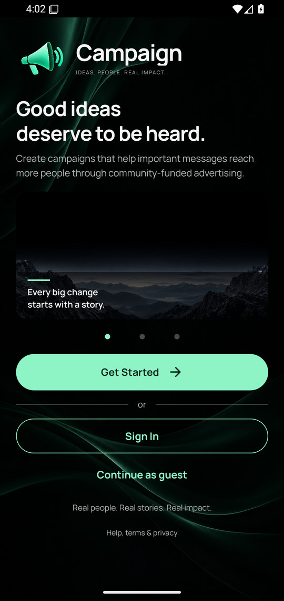</a></td>
    <td><a href="docs/screenshots/home.jpg">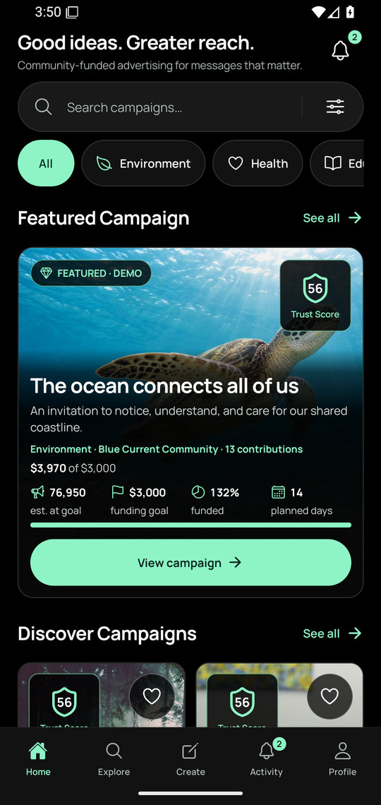</a></td>
    <td><a href="docs/screenshots/explore.jpg">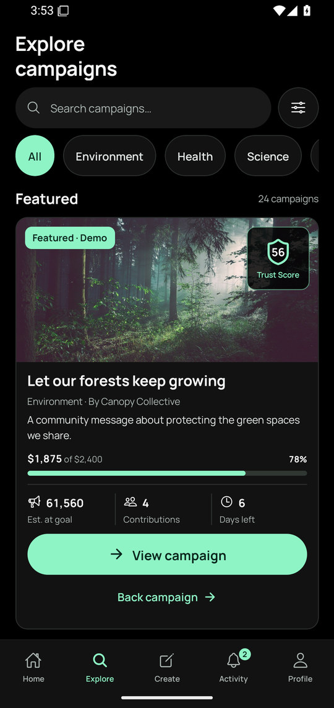</a></td>
    <td><a href="docs/screenshots/campaign-details.jpg">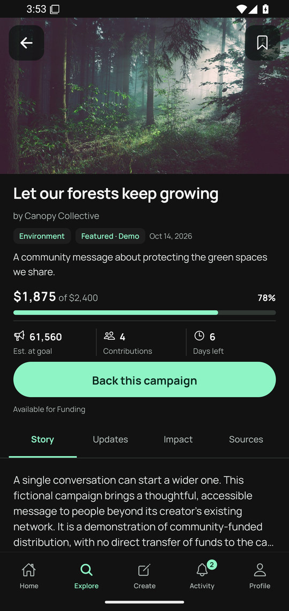</a></td>
  </tr>
</table>

### Shape your campaign

<table>
  <tr><th width="25%">Five-step overview</th><th width="25%">1 · Basics²</th><th width="25%">2 · Story²</th><th width="25%">3 · Visuals²</th></tr>
  <tr>
    <td><a href="docs/screenshots/create.jpg">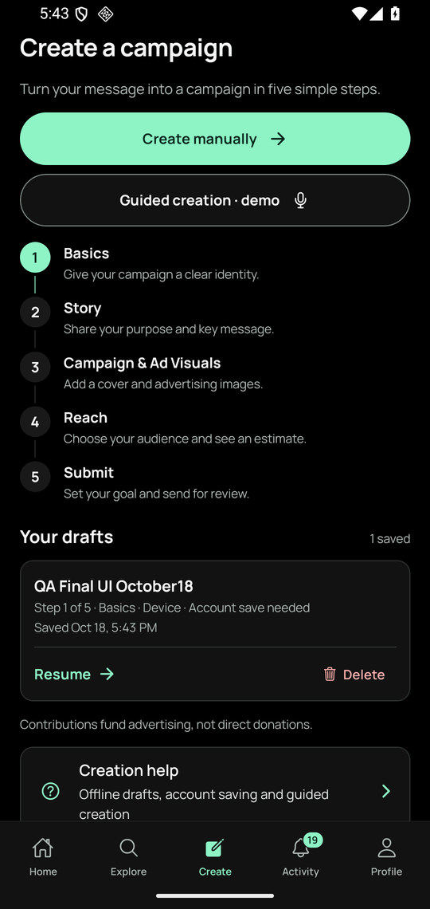</a></td>
    <td><a href="docs/screenshots/create-basics.jpg">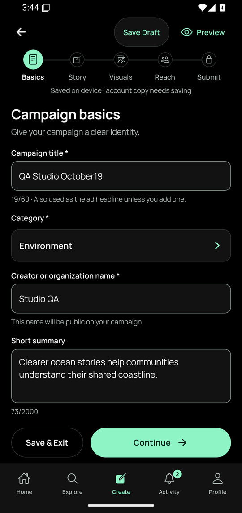</a></td>
    <td><a href="docs/screenshots/create-story.jpg">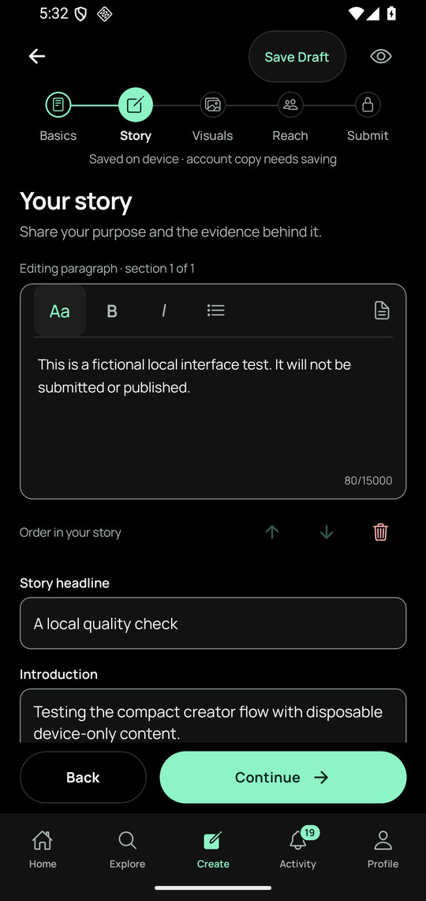</a></td>
    <td><a href="docs/screenshots/create-visuals.jpg">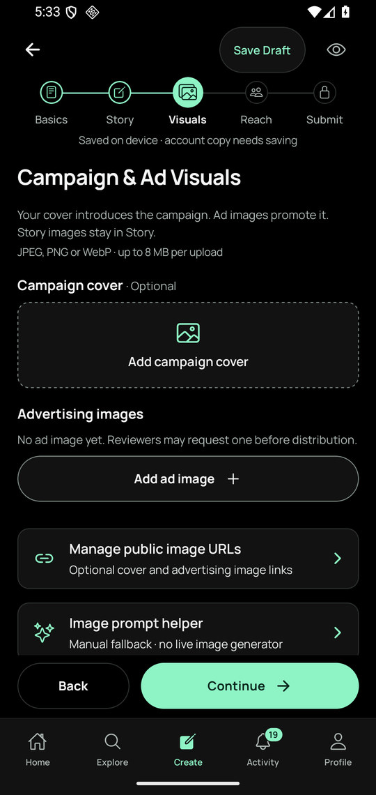</a></td>
  </tr>
</table>

### Review, then back the message

<table>
  <tr><th width="25%">4 · Reach²</th><th width="25%">5 · Submit²</th><th width="25%">Trust &amp; Verification²</th><th width="25%">Contribution²</th></tr>
  <tr>
    <td><a href="docs/screenshots/create-reach.jpg">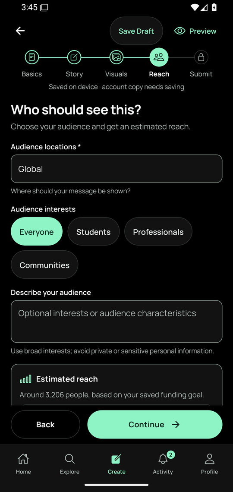</a></td>
    <td><a href="docs/screenshots/create-submit.jpg">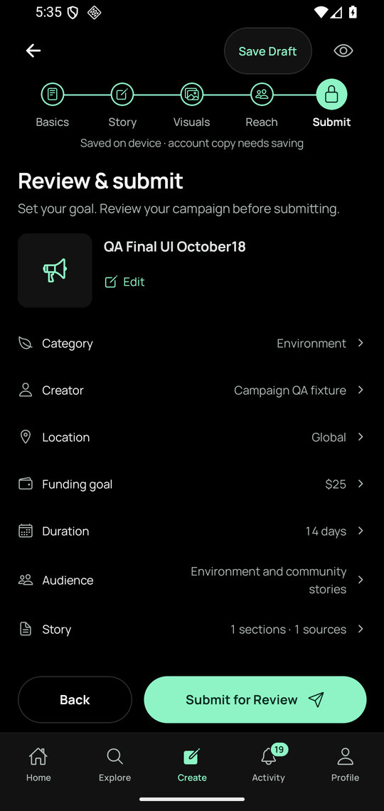</a></td>
    <td><a href="docs/screenshots/trust-verification.jpg">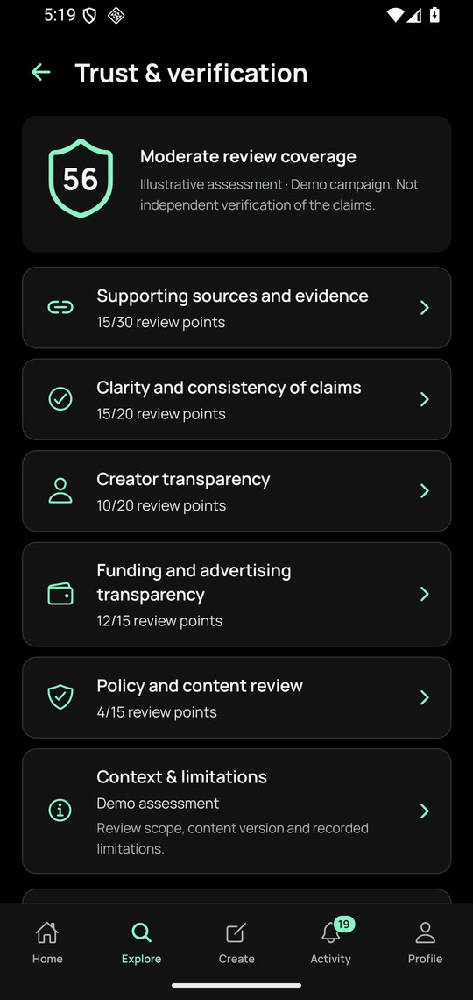</a></td>
    <td><a href="docs/screenshots/contribution.jpg">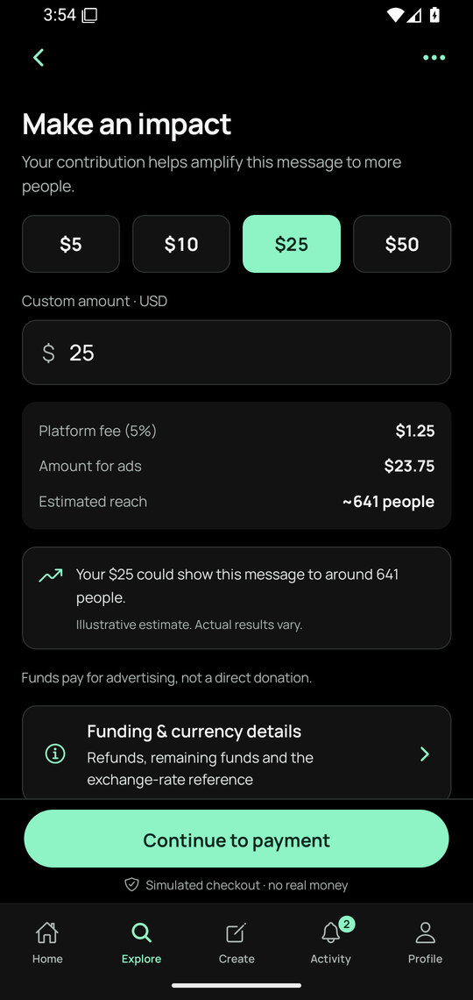</a></td>
  </tr>
</table>

### Follow the journey

<table>
  <tr><th width="25%">Activity</th><th width="25%">Campaign reports</th><th width="25%">Profile</th><th width="25%">Light appearance</th></tr>
  <tr>
    <td><a href="docs/screenshots/activity.jpg">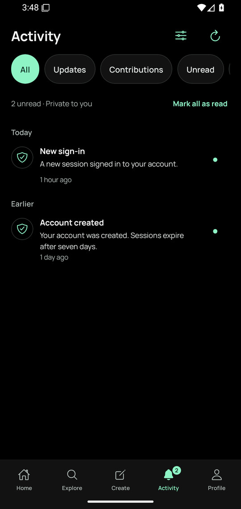</a></td>
    <td><a href="docs/screenshots/campaign-report.jpg">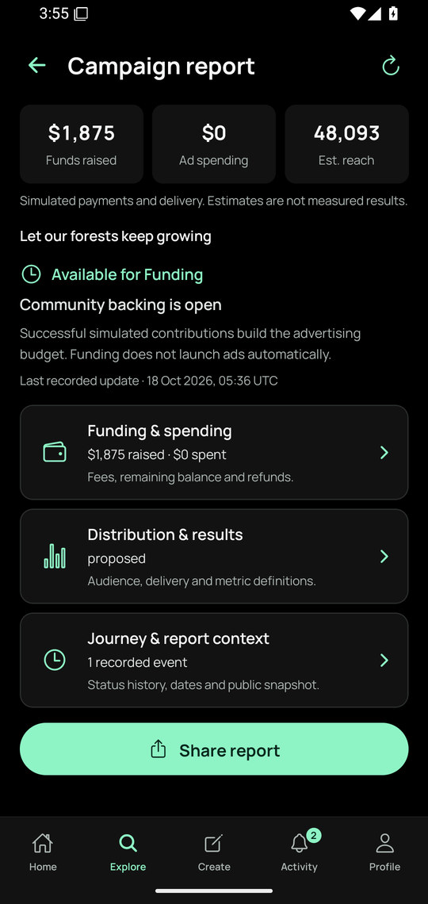</a></td>
    <td><a href="docs/screenshots/profile.jpg">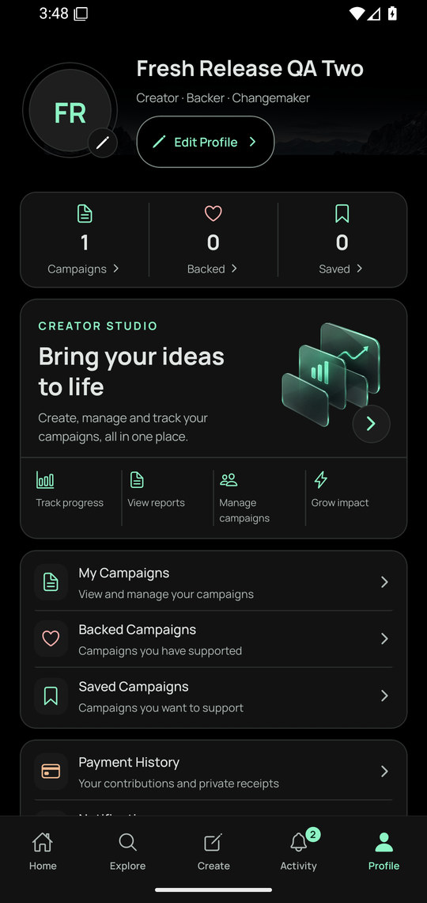</a></td>
    <td><a href="docs/screenshots/light-theme.jpg">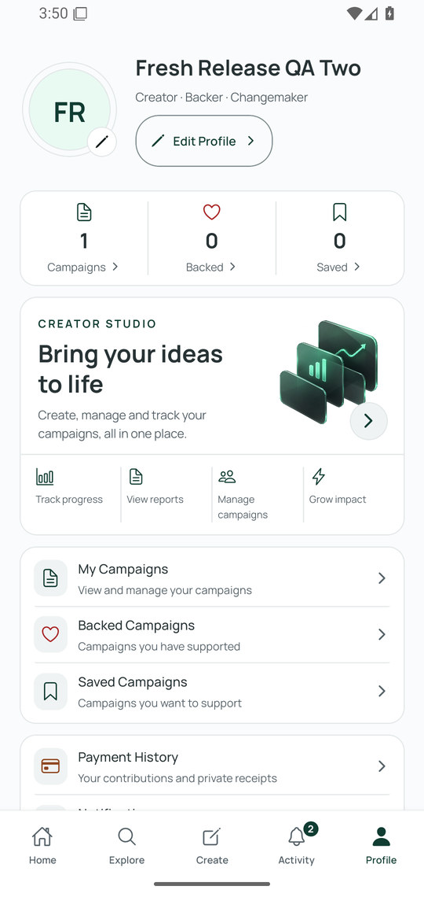</a></td>
  </tr>
</table>

<sub>¹ Welcome is an earlier verified capture of the unchanged screen; a fresh 1.4.0 capture is unavailable. ² Same-version 1.4.0 QA captures precede the final keyboard-sheet correction. These emulator screenshots are not physical-device verification. [Capture provenance](docs/screenshots/README.md).</sub>

---

## What Campaign does

Campaign helps people discover messages, understand their supporting sources, and pool a budget to help those messages reach more people. The same account can read, create, back, and follow campaigns.

### Key features

- **Image-led discovery:** search, topic filters, saved campaigns, and swipeable Explore categories.
- **Five-step creation:** manual editing or a labelled guided demo, draft saving/resumption, separate story and advertising media, previews, and submission for review.
- **Explainable review:** public sources, content-bound Trust Scores, detailed assessment criteria, and a role-restricted review demonstration.
- **Transparent backing:** presets and custom amounts, visible fees and advertising allocation, uncertain reach estimates, simulated checkout, and private payment history.
- **Connected progress:** updates, Activity filters, quick notifications, lifecycle reports, and native PDF report sharing.
- **Personal controls:** guest browsing, profile photos, Light/Dark/System appearance, and USD/INR display and entry with canonical USD accounting.

## How Campaign works

**Create → Review → Fund → Amplify → Track**

| Stage | What happens |
| --- | --- |
| **Create** | Basics → Story → Campaign & Ad Visuals → Reach → Submit. Save a draft, preview it, and set the goal at Submit. |
| **Review** | An authorized reviewer can approve, request corrections, or reject. Submission is not immediate publication. |
| **Fund** | Backers review the amount, fees, ad allocation, and estimated reach before simulated checkout. |
| **Amplify** | Distribution preparation and authorization are separate from funding. Reaching a goal does not automatically start ads. |
| **Track** | Follow updates and reports covering funding, spending, remaining funds/refunds, and clearly classified delivery figures. |

## Technology & architecture

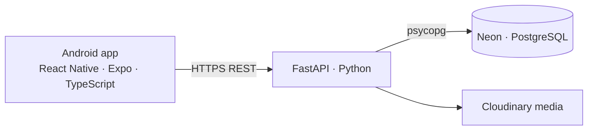

| Layer | Implementation |
| --- | --- |
| Mobile | React Native 0.83, Expo SDK 55, TypeScript 5.9, Expo Router, native paging, and Hermes |
| State & device storage | TanStack Query, SecureStore sessions, scoped AsyncStorage drafts/preferences |
| API | FastAPI, server validation, ownership/reviewer permissions, transactional simulated accounting |
| Persistence & media | Neon PostgreSQL through psycopg; authenticated Cloudinary media through the API. SQLite remains the local development default. |
| Hosting | Existing Render-hosted HTTPS API; provider credentials stay server-side |

Source lives in [`apps/mobile`](apps/mobile) and [`services/api`](services/api). Build helpers and runbooks live in [`scripts`](scripts) and [`docs`](docs).

## Prototype disclosures

**No real money is charged and no advertising is purchased or delivered.** Contributions represent an advertising budget, not a transfer to a creator or a donation to the underlying cause. Fees, allocations, refunds, and delivery workflows use simulated accounting.

Reach figures are estimates; simulated delivery figures are not measured real-world results. Demo Trust Scores are illustrative, versioned rubric assessments with recorded evidence and limitations—not endorsements or independent verification of claims. New user campaigns begin unassessed. Guided creation uses an editable demo/manual fallback; live speech, AI image generation, and advertising integrations are not connected.

## Install on Android

1. Open [GitHub Releases](/tejassambhus17/Campaign/releases) and download `Campaign.apk` once it is published.
2. Use an ARM64 Android device running Android 7.0 or later. Internet is needed for hosted campaigns, sign-in, and uploads.
3. Open the APK and follow Android’s installation prompts. Expo Go and Metro are not needed.
4. Launch **Campaign**. Browse as a guest, or create/sign in to an account for account-bound actions.

Updates require the same signing certificate. If Android reports an incompatible signature, preserve the existing installation and local drafts; do not clear data or uninstall to force an update. Release signing does not imply Google Play certification or eliminate sideloading warnings.

<details>
<summary><strong>Run the source locally</strong></summary>

Use Node 20.19.4+ and Python 3.12. Existing Windows launchers expect `E:\Campaign`.

```powershell
Set-Location E:\Campaign
Push-Location apps/mobile
npm ci
Pop-Location
python -m venv services/api/.venv
& .\services\api\.venv\Scripts\python.exe -m pip install -r .\services\api\requirements.txt
.\start-local.cmd
```

This starts the separate local SQLite API and Expo web preview for development. See the [Android guide](docs/ANDROID_LOCAL.md) for native setup and reachable API configuration, and the [Neon runbook](docs/NEON_SETUP.md) for hosted PostgreSQL. Keep environment files, signing keys, local data, and provider credentials out of Git.

</details>

## Demo video

A narrated **4m 08s** end-to-end walkthrough is prepared locally, covering creation, review, simulated backing, distribution, and reporting. **A shareable video link is pending.** The existing recording predates the 1.4.0 visual refinements; the gallery shows the newer interface. [Video and release handoff](docs/README_MEDIA.md).

## Hackathon project

Built for the **Campaign Amplification Hackathon**: a native mobile prototype focused on community-funded message amplification, a clear review/funding lifecycle, transparent use of funds, and a polished Android experience. The original 25-page brief remains the product source of truth.

The latest build has recorded automated and scoped Android emulator checks. Physical release-build acceptance and unfamiliar-user usability testing remain pending; this README does not claim whole-app verification or organizer submission.

| Documentation | Purpose |
| --- | --- |
| [Requirements](REQUIREMENTS.md) | PDF coverage and implementation evidence |
| [Release readiness](RELEASE_READINESS.md) | Build-specific checks, limits, and remaining gates |
| [Android workflow](docs/ANDROID_LOCAL.md) | Local installation, builds, and native QA |
| [Trust rubric](docs/TRUST_RUBRIC.md) | Assessment criteria, provenance, and limitations |
| [Design system](DESIGN.md) | Brand, themes, typography, and interactions |

<p align="center"><strong>Ideas. People. Real Impact.</strong></p>
